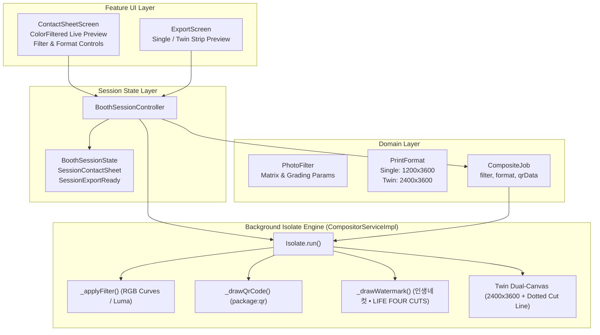

# Korean Photobooth Authenticity Enhancement Implementation Plan

> **For agentic workers:** REQUIRED SUB-SKILL: Use superpowers:subagent-driven-development to implement this plan task-by-task. Steps use checkbox (`- [ ]`) syntax for tracking.

**Goal:** Implement Milestone 2 of the Korean 4-Cut Photobooth Flutter application — adding real-time Photo Tone Filters (`Original`, `Haru Blue`, `Warm Film`, `Film Noir`), authentic corner QR Code & `인생네컷` studio watermark rendering, and Twin Strip ("1+1") 4×6 inch (2400×3600 px) dual-print compositing.

**Architecture:** Extend domain contracts (`PhotoFilter`, `PrintFormat`, `CompositeJob`), propagate selection state via `BoothSessionController`, implement pure-Dart pixel color grading and procedural QR matrix generation in the background worker isolate (`CompositorServiceImpl`), and integrate responsive live-filter previews in `ContactSheetScreen` and `ExportScreen`.

**Architecture Diagram:**



**Tech Stack:**
- Flutter 3.44+ / Dart 3.12+
- `package:image ^4.5.4` (Pure Dart isolate pixel manipulation)
- `package:qr ^4.0.0` (Procedural QR code matrix generation)
- `package:flutter_test` & `package:mocktail ^1.0.4`

**Spec:** [docs/superpowers/specs/2026-10-21-korean-photobooth-authenticity-enhancement.md](file:///c:/Projects/photobooth/docs/superpowers/specs/2026-10-21-korean-photobooth-authenticity-enhancement.md)

## Global Constraints

- Offline-first: QR generation and color grading must not require internet access.
- Memory safe: Source photos must be downscaled to $2\times$ slot bounds prior to filtering to prevent isolate heap overflow on low-memory devices.
- Non-destructive: Raw burst captures remain unaltered on disk; filters are applied only during strip baking.
- Strict type safety with sealed classes in `BoothSessionState`.
- Zero temp file leakage on cancel or session finalize.

## Review Focus

1. **Matrix Preview vs. Isolate Baking Parity**: The visual appearance of `PhotoFilter.haruBlue` or `mono` in `ColorFiltered` must closely match the baked PNG output from the compositor isolate.
2. **Twin Strip Cut Line Alignment**: The center vertical dotted guide and scissor symbol at $X = 1200$ must never overlap photo slot bounds on either strip.
3. **Corner QR Code Contrast**: QR code modules must be rendered in the frame's `captionColorValue` to ensure scan readability on dark or light backgrounds.
4. **Isolate Memory with Dual 2400×3600 Canvas**: Allocating the 2400×3600 image buffer in the worker isolate must safely succeed without OOM errors.
5. **Selection Invariance**: Changing filters or print formats on `ContactSheetScreen` must preserve the selected photos and their custom drag-reordered sequence.

---

### Task 1: Core Domain Models & Contracts (`PhotoFilter`, `PrintFormat`, and `CompositeJob`)

**Files:**
- Create: `lib/core/models/photo_filter.dart`
- Create: `lib/core/models/print_format.dart`
- Modify: `lib/core/models/composite_job.dart`
- Modify: `lib/core/models/session_state.dart`
- Create: `test/unit/photo_filter_test.dart`
- Modify: `test/unit/domain_models_test.dart`

**Interfaces:**
- Produces: `enum PhotoFilter { none, haruBlue, warmFilm, mono }`
- Produces: `enum PrintFormat { singleStrip, twinStrip }`
- Modifies: `CompositeJob` constructor with `filter`, `printFormat`, `studioWatermark`, `qrData`
- Modifies: `SessionContactSheet` with `selectedFilter`, `selectedPrintFormat`, and `copyWith`

- [ ] **Step 1: Write the failing unit tests for `PhotoFilter` and `PrintFormat`**

```dart
// test/unit/photo_filter_test.dart
import 'package:flutter_test/flutter_test.dart';
import 'package:photobooth/core/models/photo_filter.dart';
import 'package:photobooth/core/models/print_format.dart';
import 'package:photobooth/core/models/composite_job.dart';
import 'package:photobooth/core/models/frame_template.dart';
import 'package:photobooth/core/models/layout_type.dart';

void main() {
  test('PhotoFilter enum contains all specified presets with valid 20-element matrices', () {
    expect(PhotoFilter.values.length, 4);
    for (final filter in PhotoFilter.values) {
      expect(filter.matrix.length, 20, reason: '${filter.name} matrix must have 20 elements');
      expect(filter.displayName.isNotEmpty, isTrue);
    }
    expect(PhotoFilter.none.displayName, 'Original');
    expect(PhotoFilter.haruBlue.displayName, 'Haru Blue');
    expect(PhotoFilter.warmFilm.displayName, 'Warm Film');
    expect(PhotoFilter.mono.displayName, 'Film Noir');
  });

  test('PrintFormat enum defines dimensions and aspect ratios correctly', () {
    expect(PrintFormat.singleStrip.canvasWidth, 1200);
    expect(PrintFormat.singleStrip.canvasHeight, 3600);
    expect(PrintFormat.singleStrip.aspectRatio, closeTo(1 / 3, 0.001));

    expect(PrintFormat.twinStrip.canvasWidth, 2400);
    expect(PrintFormat.twinStrip.canvasHeight, 3600);
    expect(PrintFormat.twinStrip.aspectRatio, closeTo(2 / 3, 0.001));
  });

  test('CompositeJob defaults to PhotoFilter.none and PrintFormat.singleStrip', () {
    final job = CompositeJob(
      photoPaths: ['/tmp/p1.jpg'],
      frame: FrameTemplate.bundledFrames.first,
      layout: LayoutType.fourCut,
      dateString: '2026.10.21',
      outputPath: '/tmp/strip.png',
    );

    expect(job.filter, PhotoFilter.none);
    expect(job.printFormat, PrintFormat.singleStrip);
    expect(job.studioWatermark, contains('LIFE FOUR CUTS'));
    expect(job.qrData, isNotEmpty);
  });
}
```

- [ ] **Step 2: Run test to verify it fails**

Run: `flutter test test/unit/photo_filter_test.dart`
Expected: Compilation failure or FAIL (missing classes).

- [ ] **Step 3: Implement `PhotoFilter`, `PrintFormat`, and update `CompositeJob` & `SessionState`**

Create `lib/core/models/photo_filter.dart`:
```dart
enum PhotoFilter {
  none(
    displayName: 'Original',
    matrix: [
      1.0, 0.0, 0.0, 0.0, 0.0,
      0.0, 1.0, 0.0, 0.0, 0.0,
      0.0, 0.0, 1.0, 0.0, 0.0,
      0.0, 0.0, 0.0, 1.0, 0.0,
    ],
  ),
  haruBlue(
    displayName: 'Haru Blue',
    matrix: [
      0.95, 0.0,  0.05, 0.0, 10.0,
      0.0,  1.0,  0.05, 0.0, 12.0,
      0.0,  0.05, 1.15, 0.0, 20.0,
      0.0,  0.0,  0.0,  1.0, 0.0,
    ],
  ),
  warmFilm(
    displayName: 'Warm Film',
    matrix: [
      1.12, 0.05, 0.0,  0.0, 15.0,
      0.05, 1.05, 0.0,  0.0, 8.0,
      0.0,  0.0,  0.88, 0.0, -10.0,
      0.0,  0.0,  0.0,  1.0, 0.0,
    ],
  ),
  mono(
    displayName: 'Film Noir',
    matrix: [
      0.299, 0.587, 0.114, 0.0, 0.0,
      0.299, 0.587, 0.114, 0.0, 0.0,
      0.299, 0.587, 0.114, 0.0, 0.0,
      0.0,   0.0,   0.0,   1.0, 0.0,
    ],
  );

  final String displayName;
  final List<double> matrix;

  const PhotoFilter({
    required this.displayName,
    required this.matrix,
  });
}
```

Create `lib/core/models/print_format.dart`:
```dart
enum PrintFormat {
  singleStrip(
    displayName: 'Single Strip',
    canvasWidth: 1200,
    canvasHeight: 3600,
    aspectRatio: 1 / 3,
  ),
  twinStrip(
    displayName: 'Twin Strip (1+1)',
    canvasWidth: 2400,
    canvasHeight: 3600,
    aspectRatio: 2 / 3,
  );

  final String displayName;
  final int canvasWidth;
  final int canvasHeight;
  final double aspectRatio;

  const PrintFormat({
    required this.displayName,
    required this.canvasWidth,
    required this.canvasHeight,
    required this.aspectRatio,
  });
}
```

Update `lib/core/models/composite_job.dart` with optional `filter`, `printFormat`, `studioWatermark`, and `qrData`.
Update `lib/core/models/session_state.dart` in `SessionContactSheet` to add `selectedFilter` and `selectedPrintFormat`.

- [ ] **Step 4: Run test to verify it passes**

Run: `flutter test test/unit/photo_filter_test.dart`
Expected: PASS.

- [ ] **Step 5: Commit**

```bash
git add lib/core/models/photo_filter.dart lib/core/models/print_format.dart lib/core/models/composite_job.dart lib/core/models/session_state.dart test/unit/photo_filter_test.dart
git commit -m "feat(models): add PhotoFilter, PrintFormat, and extend CompositeJob contracts"
```

---

### Task 2: State Machine Extension in `BoothSessionController`

**Files:**
- Modify: `lib/features/session/controllers/booth_session_controller.dart`
- Test: `test/unit/booth_session_controller_test.dart`

**Interfaces:**
- Consumes: `PhotoFilter`, `PrintFormat`
- Produces: `setFilter(PhotoFilter filter)`, `setPrintFormat(PrintFormat format)`
- Updates: `confirmSelection()` passes current `selectedFilter` and `selectedPrintFormat` into `CompositeJob`

- [ ] **Step 1: Write failing unit test in `booth_session_controller_test.dart`**

```dart
test('setFilter and setPrintFormat update SessionContactSheet state', () async {
  // Move controller to SessionContactSheet
  // Verify setFilter(PhotoFilter.haruBlue) updates state.selectedFilter
  // Verify setPrintFormat(PrintFormat.twinStrip) updates state.selectedPrintFormat
});
```

- [ ] **Step 2: Run test to verify it fails**

Run: `flutter test test/unit/booth_session_controller_test.dart`
Expected: FAIL (missing methods on controller).

- [ ] **Step 3: Implement `setFilter` and `setPrintFormat` in `BoothSessionController`**

Add methods:
```dart
void setFilter(PhotoFilter filter) {
  final s = value;
  if (s is SessionContactSheet) {
    value = s.copyWith(selectedFilter: filter);
  }
}

void setPrintFormat(PrintFormat format) {
  final s = value;
  if (s is SessionContactSheet) {
    value = s.copyWith(selectedPrintFormat: format);
  }
}
```
Update `confirmSelection()`:
```dart
final job = CompositeJob(
  photoPaths: selectedPaths,
  frame: frame,
  layout: layout,
  dateString: dateStr,
  outputPath: outPath,
  filter: s.selectedFilter,
  printFormat: s.selectedPrintFormat,
  qrData: 'https://photobooth.app/strip?s=$_sessionId',
);
```

- [ ] **Step 4: Run test to verify it passes**

Run: `flutter test test/unit/booth_session_controller_test.dart`
Expected: PASS.

- [ ] **Step 5: Commit**

```bash
git add lib/features/session/controllers/booth_session_controller.dart test/unit/booth_session_controller_test.dart
git commit -m "feat(controller): add filter and print format state management"
```

---

### Task 3: Background Isolate Compositor Engine (`CompositorServiceImpl`)

**Files:**
- Modify: `lib/services/compositor_service_impl.dart`
- Test: `test/unit/compositor_isolate_test.dart`

**Interfaces:**
- Consumes: `CompositeJob` with `filter`, `printFormat`, `studioWatermark`, `qrData`
- Produces: Rendered PNG file at `job.outputPath` (1200×3600 for Single, 2400×3600 for Twin)

- [ ] **Step 1: Write failing compositor tests for filters, QR code, and twin strip**

```dart
test('renderStrip applies PhotoFilter.mono correctly in isolate', () async {
  // Feed colored input photo
  // Verify baked output photo slot has equal R=G=B (grayscale)
});

test('renderStrip renders twinStrip (2400x3600) with center cut line', () async {
  // Render strip with PrintFormat.twinStrip
  // Verify output image dimensions are exactly 2400 x 3600
});
```

- [ ] **Step 2: Run test to verify it fails**

Run: `flutter test test/unit/compositor_isolate_test.dart`
Expected: FAIL.

- [ ] **Step 3: Implement filter shaders, QR drawing, and twin strip compositing in `CompositorServiceImpl`**

Implement `_applyFilter`:
```dart
static img.Image _applyFilter(img.Image photo, PhotoFilter filter) {
  if (filter == PhotoFilter.none) return photo;
  final result = img.Image.from(photo);
  for (final pixel in result) {
    final r = pixel.r;
    final g = pixel.g;
    final b = pixel.b;
    final a = pixel.a;

    if (filter == PhotoFilter.mono) {
      final y = (0.299 * r + 0.587 * g + 0.114 * b).round().clamp(0, 255);
      pixel.r = y;
      pixel.g = y;
      pixel.b = y;
    } else if (filter == PhotoFilter.haruBlue) {
      pixel.r = (r * 0.95 + 10).round().clamp(0, 255);
      pixel.g = (g * 1.00 + 12).round().clamp(0, 255);
      pixel.b = (b * 1.15 + 20).round().clamp(0, 255);
    } else if (filter == PhotoFilter.warmFilm) {
      pixel.r = (r * 1.12 + 15).round().clamp(0, 255);
      pixel.g = (g * 1.05 + 8).round().clamp(0, 255);
      pixel.b = (b * 0.88 - 10).round().clamp(0, 255);
    }
  }
  return result;
}
```

Implement `_drawQrCode`:
```dart
static void _drawQrCode(
  img.Image canvas,
  String data,
  int startX,
  int startY,
  int targetSize,
  img.Color fgColor,
  img.Color bgColor,
) {
  final qrCode = QrCode.fromData(data: data, errorCorrectLevel: QrErrorCorrectLevel.M);
  final moduleCount = qrCode.moduleCount;
  final modulePixelSize = (targetSize / (moduleCount + 2)).floor();
  final offset = ((targetSize - (modulePixelSize * (moduleCount + 2))) ~/ 2);

  // Quiet zone
  img.fillRect(
    canvas,
    x1: startX + offset,
    y1: startY + offset,
    x2: startX + offset + (moduleCount + 2) * modulePixelSize,
    y2: startY + offset + (moduleCount + 2) * modulePixelSize,
    color: bgColor,
  );

  // Modules
  for (int r = 0; r < moduleCount; r++) {
    for (int c = 0; c < moduleCount; c++) {
      if (qrCode.isDark(r, c)) {
        img.fillRect(
          canvas,
          x1: startX + offset + (c + 1) * modulePixelSize,
          y1: startY + offset + (r + 1) * modulePixelSize,
          x2: startX + offset + (c + 2) * modulePixelSize,
          y2: startY + offset + (r + 2) * modulePixelSize,
          color: fgColor,
        );
      }
    }
  }
}
```

Implement `_renderStripInternal`:
- Render base 1200×3600 single strip with filtered photos, watermark, date stamp, and corner QR code.
- If `job.printFormat == PrintFormat.twinStrip`:
  - Create `final twinCanvas = img.Image(width: 2400, height: 3600)`.
  - Draw base strip at `(0, 0)` and duplicate at `(1200, 0)`.
  - Draw vertical dashed line down `X = 1200` with scissor indicator.
  - Return encoded PNG bytes.

- [ ] **Step 4: Run test to verify it passes**

Run: `flutter test test/unit/compositor_isolate_test.dart`
Expected: PASS.

- [ ] **Step 5: Commit**

```bash
git add lib/services/compositor_service_impl.dart test/unit/compositor_isolate_test.dart
git commit -m "feat(compositor): add filter color grading, QR code, and twin-strip compositing in isolate"
```

---

### Task 4: Contact Sheet Live Filter & Format Selection (`ContactSheetScreen`)

**Files:**
- Modify: `lib/features/contact_sheet/screens/contact_sheet_screen.dart`
- Test: `test/widget/contact_sheet_screen_test.dart`

**Interfaces:**
- Consumes: `PhotoFilter`, `PrintFormat`, `BoothSessionController.setFilter`, `BoothSessionController.setPrintFormat`
- Produces: Visual filter chips and print format segmented control in `ContactSheetScreen`

- [ ] **Step 1: Write failing widget test for filter bar & format toggle**

```dart
testWidgets('ContactSheetScreen renders filter chips and print format toggle', (tester) async {
  // Pump screen with 6 shots
  // Expect to find 'Original', 'Haru Blue', 'Warm Film', 'Film Noir'
  // Expect to find 'Single Strip' and 'Twin Strip (1+1)'
  // Tap 'Haru Blue' and verify controller.state.selectedFilter is PhotoFilter.haruBlue
});
```

- [ ] **Step 2: Run test to verify it fails**

Run: `flutter test test/widget/contact_sheet_screen_test.dart`
Expected: FAIL.

- [ ] **Step 3: Update `ContactSheetScreen` with filter selector and format toggle**

- Wrap thumbnail tiles with `ColorFiltered(colorFilter: ColorFilter.matrix(sheet.selectedFilter.matrix), child: ...)`
- Add horizontal filter selector row above "Bake Film Strip" button.
- Add print format toggle row (`Single Strip` vs `Twin (1+1)`).

- [ ] **Step 4: Run test to verify it passes**

Run: `flutter test test/widget/contact_sheet_screen_test.dart`
Expected: PASS.

- [ ] **Step 5: Commit**

```bash
git add lib/features/contact_sheet/screens/contact_sheet_screen.dart test/widget/contact_sheet_screen_test.dart
git commit -m "feat(contact_sheet): add live photo filter selection and print format toggle"
```

---

### Task 5: Export Screen & Full E2E Flow Integration

**Files:**
- Modify: `lib/features/export/screens/export_screen.dart`
- Modify: `test/widget/export_screen_test.dart`
- Modify: `test/flows/full_photobooth_flow_test.dart`

**Interfaces:**
- Consumes: `SessionExportReady`, `PrintFormat`
- Produces: Dynamic aspect ratio preview for 1:3 (Single) and 2:3 (Twin 1+1).

- [ ] **Step 1: Write failing E2E flow test for filter and twin strip selection**

Update `test/flows/full_photobooth_flow_test.dart` to select `Haru Blue` and `Twin Strip (1+1)`, bake strip, and verify export ready.

- [ ] **Step 2: Run test to verify it fails**

Run: `flutter test test/flows/full_photobooth_flow_test.dart`
Expected: FAIL.

- [ ] **Step 3: Update `ExportScreen` and complete integration**

- Adjust `ExportScreen` container aspect ratio based on whether the baked file is 1:3 or 2:3.
- Verify clean finish / reset without temp leaks.

- [ ] **Step 4: Run full test suite to verify everything passes**

Run: `flutter test`
Expected: All unit, widget, and flow tests PASS.

- [ ] **Step 5: Commit**

```bash
git add lib/features/export/screens/export_screen.dart test/widget/export_screen_test.dart test/flows/full_photobooth_flow_test.dart
git commit -m "feat(export): integrate twin-strip preview and verify full end-to-end photobooth flow"
```
