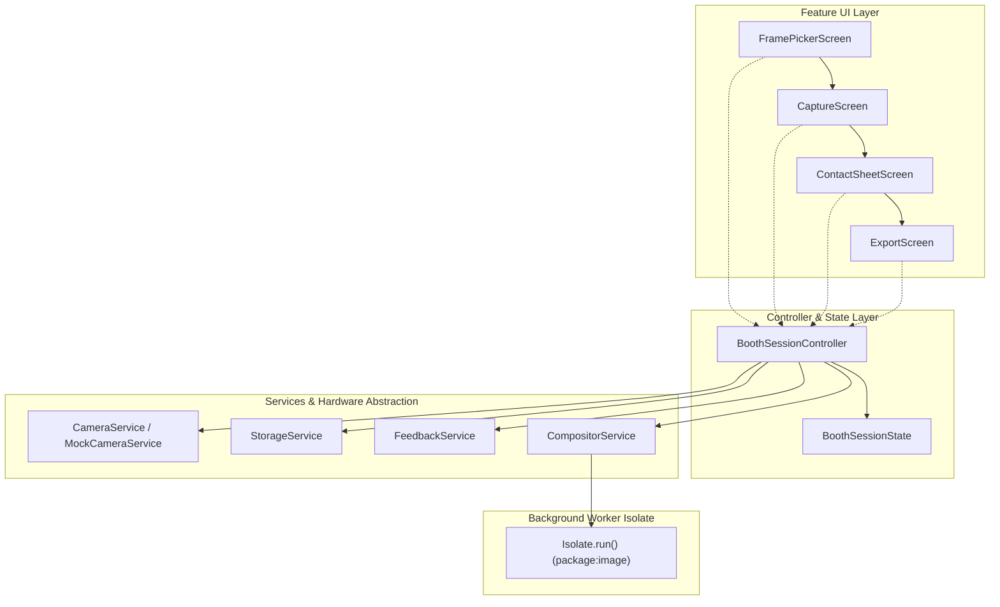

# Korean 4-Cut Photobooth (Core Flow MVP) Implementation Plan

> **For agentic workers:** REQUIRED SUB-SKILL: Use superpowers:subagent-driven-development to implement this plan task-by-task. Steps use checkbox (`- [ ]`) syntax for tracking.

**Goal:** Build Milestone 1 of the Korean 4-Cut Photobooth Android app in Flutter — delivering an end-to-end ritual from frame & layout selection, timed burst camera capture with pose guidance and haptic/flash feedback, contact sheet selection and drag reordering, headless pure Dart isolate strip compositing (1200×3600 px, 300 DPI), to camera roll / share sheet export and zero-leak storage cleanup.

**Architecture:** A unidirectional session state machine (`BoothSessionController`) coordinates the lifecycle. Hardware access (`CameraService`, `StorageService`, `FeedbackService`) is strictly abstracted behind interfaces to allow complete headless testing via `MockCameraService`. High-resolution film-strip rendering runs asynchronously in a pure Dart background worker isolate (`Isolate.run()`) using `package:image`.

**Architecture Diagram:**



**Tech Stack:**
- Flutter 3.44+ / Dart 3.12+ (Android API 29+)
- `camera: ^0.11.1`
- `image: ^4.5.4` (Pure Dart isolate rendering)
- `path_provider: ^2.1.5` & `path: ^1.9.1`
- `shared_preferences: ^2.5.2` (Frame/layout preference persistence)
- `share_plus: ^10.1.4` & `gal: ^2.3.2` (Media export)
- `flutter_test` & `mocktail: ^1.0.4`

**Spec:** [docs/superpowers/specs/2026-10-21-korean-photobooth-design.md](file:///c:/Projects/photobooth/docs/superpowers/specs/2026-10-21-korean-photobooth-design.md)

## Global Constraints

- Android API 29+ compatibility; no iOS-specific build dependencies.
- Completely offline-first; no network calls or cloud services in Milestone 1.
- Raw burst captures must never persist beyond session completion, cancellation, or retake.
- Post-capture image processing only; compositing runs off-thread in a background isolate.
- Strict type safety with sealed session state classes.

## Review Focus

1. **Camera unavailable / headless test environment:** App must not crash if no camera hardware is present; `MockCameraService` must seamlessly substitute.
2. **Back-to-back duplicate pose prompts:** Pose prompt rotation must never produce two identical consecutive prompts in a burst.
3. **Selection count enforcement:** "Bake Strip" / "Next" on the contact sheet must be strictly disabled unless selected count equals $N$.
4. **Temp file leaking on abort:** Tapping "Cancel" during countdown or burst must immediately delete all temporary image files on disk.
5. **Isolate decoding memory bounds:** Composite rendering must handle large input photos without throwing out-of-memory errors on device.

---

### Task 1: Flutter Project Scaffolding & Dependencies

**Files:**
- Create: `pubspec.yaml`
- Create: `analysis_options.yaml`
- Create: `android/app/build.gradle`
- Create: `android/app/src/main/AndroidManifest.xml`
- Test: `test/smoke_test.dart`

**Interfaces:**
- Produces: Project root structure, dependency graph, and base build config.

- [ ] **Step 1: Write the failing smoke test**

```dart
// test/smoke_test.dart
import 'package:flutter_test/flutter_test.dart';

void main() {
  test('project environment smoke test', () {
    expect(true, isTrue);
  });
}
```

- [ ] **Step 2: Run test to verify initial state**

Run: `flutter test test/smoke_test.dart`
Expected: Passes once project scaffolding exists.

- [ ] **Step 3: Initialize Flutter project and configure `pubspec.yaml`**

Create `pubspec.yaml` with dependencies: `camera: ^0.11.1`, `image: ^4.5.4`, `path_provider: ^2.1.5`, `path: ^1.9.1`, `shared_preferences: ^2.5.2`, `share_plus: ^10.1.4`, `gal: ^2.3.2`, `mocktail: ^1.0.4`. Ensure Android manifest includes camera and vibration permissions.

- [ ] **Step 4: Run `flutter pub get` and verify smoke test**

Run: `flutter pub get && flutter test test/smoke_test.dart`
Expected: PASS

- [ ] **Step 5: Commit**

```bash
git add pubspec.yaml analysis_options.yaml android/ test/smoke_test.dart
git commit -m "chore: scaffold Flutter project and configure dependencies"
```

---

### Task 2: Core Domain Models & Configuration

**Files:**
- Create: `lib/core/config/app_constants.dart`
- Create: `lib/core/config/pose_prompts.dart`
- Create: `lib/core/models/layout_type.dart`
- Create: `lib/core/models/frame_template.dart`
- Create: `lib/core/models/captured_photo.dart`
- Create: `lib/core/models/composite_job.dart`
- Create: `lib/core/models/session_state.dart`
- Test: `test/unit/domain_models_test.dart`

**Interfaces:**
- Produces: `LayoutType`, `FrameTemplate`, `CapturedPhoto`, `CompositeJob`, `BoothSessionState`.

- [ ] **Step 1: Write the failing domain models test**

```dart
// test/unit/domain_models_test.dart
import 'package:flutter_test/flutter_test.dart';
import 'package:photobooth/core/models/layout_type.dart';
import 'package:photobooth/core/models/frame_template.dart';
import 'package:photobooth/core/models/session_state.dart';

void main() {
  test('LayoutType parameters match specification', () {
    expect(LayoutType.fourCut.slotCount, 4);
    expect(LayoutType.fourCut.burstCount, 6);
    expect(LayoutType.sixCut.slotCount, 6);
    expect(LayoutType.sixCut.burstCount, 8);
    expect(LayoutType.single.slotCount, 1);
    expect(LayoutType.single.burstCount, 3);
  });

  test('Bundled frame templates include at least 6 classic styles', () {
    expect(FrameTemplate.bundledFrames.length, greaterThanOrEqualTo(6));
  });
}
```

- [ ] **Step 2: Run test to verify it fails**

Run: `flutter test test/unit/domain_models_test.dart`
Expected: FAIL with compilation errors (unresolved identifiers).

- [ ] **Step 3: Implement domain models and configuration**

Implement `LayoutType` enum with slot/burst counts and aspect ratios, `FrameTemplate` with bundled presets (Classic Black, Vintage White, Retro Cream, Pastel Pink, Deep Navy, Muted Olive), `CapturedPhoto`, `CompositeJob`, and `BoothSessionState` sealed hierarchy in `lib/core/models/`.

- [ ] **Step 4: Run test to verify it passes**

Run: `flutter test test/unit/domain_models_test.dart`
Expected: PASS

- [ ] **Step 5: Commit**

```bash
git add lib/core/ test/unit/domain_models_test.dart
git commit -m "feat: add domain models, layouts, and frame presets"
```

---

### Task 3: Storage Service & Temp Lifecycle Manager

**Files:**
- Create: `lib/core/services/storage_service.dart`
- Create: `lib/services/storage_service_impl.dart`
- Test: `test/unit/storage_service_test.dart`

**Interfaces:**
- Consumes: `path_provider`, `path`.
- Produces: `StorageService` interface with `createSessionDir()`, `saveTempShot()`, `clearSession()`, `cleanupOrphanedSessions()`.

- [ ] **Step 1: Write the failing storage service test**

```dart
// test/unit/storage_service_test.dart
import 'dart:io';
import 'package:flutter_test/flutter_test.dart';
import 'package:photobooth/services/storage_service_impl.dart';

void main() {
  late Directory tempBaseDir;
  late StorageServiceImpl storageService;

  setUp(() async {
    tempBaseDir = await Directory.systemTemp.createTemp('storage_test_');
    storageService = StorageServiceImpl(baseDirectoryOverride: tempBaseDir);
  });

  tearDown(() async {
    if (await tempBaseDir.exists()) {
      await tempBaseDir.delete(recursive: true);
    }
  });

  test('creates session dir and cleans up on clearSession', () async {
    final sessionDir = await storageService.createSessionDirectory('session_123');
    expect(await sessionDir.exists(), isTrue);

    final dummyFile = File('${sessionDir.path}/shot_1.jpg');
    await dummyFile.writeAsString('test');
    expect(await dummyFile.exists(), isTrue);

    await storageService.clearSession('session_123');
    expect(await sessionDir.exists(), isFalse);
  });

  test('cleanupOrphanedSessions deletes stale directories', () async {
    await storageService.createSessionDirectory('stale_1');
    await storageService.createSessionDirectory('stale_2');
    await storageService.cleanupOrphanedSessions(activeSessionId: 'stale_2');

    final dir1 = Directory('${tempBaseDir.path}/sessions/stale_1');
    final dir2 = Directory('${tempBaseDir.path}/sessions/stale_2');
    expect(await dir1.exists(), isFalse);
    expect(await dir2.exists(), isTrue);
  });
}
```

- [ ] **Step 2: Run test to verify it fails**

Run: `flutter test test/unit/storage_service_test.dart`
Expected: FAIL with compilation error.

- [ ] **Step 3: Implement `StorageService` and `StorageServiceImpl`**

Implement session directory creation under `sessions/{sessionId}`, temp photo saving, orphaned session purging, and deletion on session completion/cancel.

- [ ] **Step 4: Run test to verify it passes**

Run: `flutter test test/unit/storage_service_test.dart`
Expected: PASS

- [ ] **Step 5: Commit**

```bash
git add lib/core/services/storage_service.dart lib/services/storage_service_impl.dart test/unit/storage_service_test.dart
git commit -m "feat: implement StorageService with session scoping and auto-cleanup"
```

---

### Task 4: Pose Prompt Rotation Engine

**Files:**
- Create: `lib/core/services/pose_prompt_engine.dart`
- Test: `test/unit/pose_rotator_test.dart`

**Interfaces:**
- Consumes: `lib/core/config/pose_prompts.dart`
- Produces: `PosePromptEngine.nextPrompt()` guaranteeing non-consecutive duplicates.

- [ ] **Step 1: Write the failing pose rotator test**

```dart
// test/unit/pose_rotator_test.dart
import 'package:flutter_test/flutter_test.dart';
import 'package:photobooth/core/services/pose_prompt_engine.dart';

void main() {
  test('PosePromptEngine never yields identical consecutive prompts across 1000 cycles', () {
    final engine = PosePromptEngine();
    String? previous;
    for (int i = 0; i < 1000; i++) {
      final current = engine.nextPrompt();
      expect(current.isNotEmpty, isTrue);
      expect(current, isNot(equals(previous)), reason: 'Cycle $i matched previous');
      previous = current;
    }
  });
}
```

- [ ] **Step 2: Run test to verify it fails**

Run: `flutter test test/unit/pose_rotator_test.dart`
Expected: FAIL.

- [ ] **Step 3: Implement `PosePromptEngine`**

Implement random prompt selection from the 5 PRD poses ("Finger heart 🫰", "Big arm heart 🫶", "Silly face 🤪", "Look away 😌", "Peace sign ✌️") while rejecting `_lastPrompt`.

- [ ] **Step 4: Run test to verify it passes**

Run: `flutter test test/unit/pose_rotator_test.dart`
Expected: PASS

- [ ] **Step 5: Commit**

```bash
git add lib/core/services/pose_prompt_engine.dart test/unit/pose_rotator_test.dart
git commit -m "feat: implement PosePromptEngine with non-consecutive rotation"
```

---

### Task 5: Background Isolate Compositing Service

**Files:**
- Create: `lib/core/services/compositor_service.dart`
- Create: `lib/services/compositor_service_impl.dart`
- Test: `test/unit/compositor_isolate_test.dart`

**Interfaces:**
- Consumes: `CompositeJob`, `FrameTemplate`, `package:image`.
- Produces: `Future<String> renderStrip(CompositeJob job)` running in `Isolate.run()`.

- [ ] **Step 1: Write the failing compositor test**

```dart
// test/unit/compositor_isolate_test.dart
import 'dart:io';
import 'package:flutter_test/flutter_test.dart';
import 'package:image/image.dart' as img;
import 'package:photobooth/core/models/composite_job.dart';
import 'package:photobooth/core/models/frame_template.dart';
import 'package:photobooth/core/models/layout_type.dart';
import 'package:photobooth/services/compositor_service_impl.dart';

void main() {
  late Directory testDir;
  late List<String> dummyPhotoPaths;
  late CompositorServiceImpl compositor;

  setUp(() async {
    testDir = await Directory.systemTemp.createTemp('comp_test_');
    dummyPhotoPaths = [];
    for (int i = 0; i < 4; i++) {
      final image = img.Image(width: 800, height: 600);
      img.fill(image, color: img.ColorRgb8(i * 50, 100, 200));
      final file = File('${testDir.path}/test_$i.png');
      await file.writeAsBytes(img.encodePng(image));
      dummyPhotoPaths.add(file.path);
    }
    compositor = CompositorServiceImpl();
  });

  tearDown(() async {
    if (await testDir.exists()) {
      await testDir.delete(recursive: true);
    }
  });

  test('renderStrip produces valid 1200x3600 PNG in isolate', () async {
    final outputPath = '${testDir.path}/output_strip.png';
    final job = CompositeJob(
      photoPaths: dummyPhotoPaths,
      frame: FrameTemplate.bundledFrames.first,
      layout: LayoutType.fourCut,
      dateString: '2026.10.21',
      outputPath: outputPath,
    );

    final resultPath = await compositor.renderStrip(job);
    expect(resultPath, equals(outputPath));

    final outputFile = File(resultPath);
    expect(await outputFile.exists(), isTrue);

    final decoded = img.decodePng(await outputFile.readAsBytes());
    expect(decoded, isNotNull);
    expect(decoded!.width, 1200);
    expect(decoded.height, 3600);
  });
}
```

- [ ] **Step 2: Run test to verify it fails**

Run: `flutter test test/unit/compositor_isolate_test.dart`
Expected: FAIL.

- [ ] **Step 3: Implement `CompositorServiceImpl` with `Isolate.run()`**

Allocate 1200×3600 canvas, center-crop and resize each photo to 1040×720, blit into slot offsets ($y = 120, 880, 1640, 2400$), draw date stamp centered in bottom margin, encode as PNG, and save to `job.outputPath`.

- [ ] **Step 4: Run test to verify it passes**

Run: `flutter test test/unit/compositor_isolate_test.dart`
Expected: PASS

- [ ] **Step 5: Commit**

```bash
git add lib/core/services/compositor_service.dart lib/services/compositor_service_impl.dart test/unit/compositor_isolate_test.dart
git commit -m "feat: implement isolate-driven pure Dart strip compositor"
```

---

### Task 6: Camera Service & Mock Camera Service

**Files:**
- Create: `lib/core/services/camera_service.dart`
- Create: `lib/services/camera_service_impl.dart`
- Create: `lib/services/mock_camera_service.dart`
- Test: `test/unit/mock_camera_service_test.dart`

**Interfaces:**
- Produces: `CameraService` contract, `CameraServiceImpl` (real camera package), `MockCameraService` (simulated capture returning synthetic images).

- [ ] **Step 1: Write the failing camera service test**

```dart
// test/unit/mock_camera_service_test.dart
import 'dart:io';
import 'package:flutter/widgets.dart';
import 'package:flutter_test/flutter_test.dart';
import 'package:photobooth/services/mock_camera_service.dart';

void main() {
  testWidgets('MockCameraService initializes, renders preview widget, and takes picture', (tester) async {
    final mockCamera = MockCameraService();
    await mockCamera.initialize();
    expect(mockCamera.isInitialized, isTrue);

    await tester.pumpWidget(Directionality(
      textDirection: TextDirection.ltr,
      child: mockCamera.buildPreview(),
    ));
    expect(find.byType(Widget), findsWidgets);

    final tempDir = await Directory.systemTemp.createTemp('mock_cam_');
    final shotPath = await mockCamera.takePicture(tempDir.path);
    expect(await File(shotPath).exists(), isTrue);

    await tempDir.delete(recursive: true);
    await mockCamera.dispose();
  });
}
```

- [ ] **Step 2: Run test to verify it fails**

Run: `flutter test test/unit/mock_camera_service_test.dart`
Expected: FAIL.

- [ ] **Step 3: Implement `CameraService`, `CameraServiceImpl`, and `MockCameraService`**

Implement interface, real device camera wrapper with lens fallback and portrait lock, and headless mock camera that synthesizes small test JPEG images.

- [ ] **Step 4: Run test to verify it passes**

Run: `flutter test test/unit/mock_camera_service_test.dart`
Expected: PASS

- [ ] **Step 5: Commit**

```bash
git add lib/core/services/camera_service.dart lib/services/camera_service_impl.dart lib/services/mock_camera_service.dart test/unit/mock_camera_service_test.dart
git commit -m "feat: implement CameraService contract and MockCameraService for tests"
```

---

### Task 7: Feedback Service (Haptics & Cues)

**Files:**
- Create: `lib/core/services/feedback_service.dart`
- Create: `lib/services/feedback_service_impl.dart`
- Test: `test/unit/feedback_service_test.dart`

**Interfaces:**
- Produces: `FeedbackService` with `countdownTick()`, `countdownFinalBeep()`, `shutterCue()`.

- [ ] **Step 1: Write the failing feedback service test**

```dart
// test/unit/feedback_service_test.dart
import 'package:flutter_test/flutter_test.dart';
import 'package:photobooth/services/feedback_service_impl.dart';

void main() {
  test('FeedbackService runs haptic and audio triggers without unhandled exceptions', () async {
    final service = FeedbackServiceImpl(enableAudio: false); // headless
    await service.countdownTick();
    await service.countdownFinalBeep();
    await service.shutterCue();
    expect(true, isTrue);
  });
}
```

- [ ] **Step 2: Run test to verify it fails**

Run: `flutter test test/unit/feedback_service_test.dart`
Expected: FAIL.

- [ ] **Step 3: Implement `FeedbackServiceImpl`**

Wrap `HapticFeedback.lightImpact()` / `mediumImpact()` and tone generation/audio cues, with headless graceful fallback.

- [ ] **Step 4: Run test to verify it passes**

Run: `flutter test test/unit/feedback_service_test.dart`
Expected: PASS

- [ ] **Step 5: Commit**

```bash
git add lib/core/services/feedback_service.dart lib/services/feedback_service_impl.dart test/unit/feedback_service_test.dart
git commit -m "feat: implement FeedbackService for haptic and audio triggers"
```

---

### Task 8: Booth Session Controller (State Machine)

**Files:**
- Create: `lib/features/session/controllers/booth_session_controller.dart`
- Test: `test/unit/booth_session_controller_test.dart`

**Interfaces:**
- Consumes: `CameraService`, `StorageService`, `FeedbackService`, `CompositorService`, `PosePromptEngine`.
- Produces: `BoothSessionController` managing `ValueNotifier<BoothSessionState>`.

- [ ] **Step 1: Write the failing session controller test**

```dart
// test/unit/booth_session_controller_test.dart
import 'dart:io';
import 'package:flutter_test/flutter_test.dart';
import 'package:photobooth/core/models/frame_template.dart';
import 'package:photobooth/core/models/layout_type.dart';
import 'package:photobooth/core/models/session_state.dart';
import 'package:photobooth/core/services/pose_prompt_engine.dart';
import 'package:photobooth/features/session/controllers/booth_session_controller.dart';
import 'package:photobooth/services/compositor_service_impl.dart';
import 'package:photobooth/services/feedback_service_impl.dart';
import 'package:photobooth/services/mock_camera_service.dart';
import 'package:photobooth/services/storage_service_impl.dart';

void main() {
  late Directory tempDir;
  late BoothSessionController controller;
  late MockCameraService mockCamera;
  late StorageServiceImpl storage;

  setUp(() async {
    tempDir = await Directory.systemTemp.createTemp('controller_test_');
    mockCamera = MockCameraService();
    storage = StorageServiceImpl(baseDirectoryOverride: tempDir);
    controller = BoothSessionController(
      cameraService: mockCamera,
      storageService: storage,
      feedbackService: FeedbackServiceImpl(enableAudio: false),
      compositorService: CompositorServiceImpl(),
      poseEngine: PosePromptEngine(),
    );
  });

  tearDown(() async {
    await controller.dispose();
    if (await tempDir.exists()) {
      await tempDir.delete(recursive: true);
    }
  });

  test('full burst capture of 6 shots advances to ContactSheet', () async {
    await controller.startSession(LayoutType.fourCut, FrameTemplate.bundledFrames.first);
    expect(controller.state, isA<SessionCountingDown>());

    for (int i = 1; i <= 6; i++) {
      await controller.executeCaptureStep();
    }

    expect(controller.state, isA<SessionContactSheet>());
    final sheet = controller.state as SessionContactSheet;
    expect(sheet.allShots.length, 6);
  });

  test('confirmSelection requires exactly N shots', () async {
    await controller.startSession(LayoutType.fourCut, FrameTemplate.bundledFrames.first);
    for (int i = 1; i <= 6; i++) {
      await controller.executeCaptureStep();
    }

    final sheet = controller.state as SessionContactSheet;
    // Select only 3 shots (invalid for 4-cut)
    controller.selectShot(sheet.allShots[0].id);
    controller.selectShot(sheet.allShots[1].id);
    controller.selectShot(sheet.allShots[2].id);
    expect(controller.canConfirmSelection, isFalse);

    // Select 4th shot
    controller.selectShot(sheet.allShots[3].id);
    expect(controller.canConfirmSelection, isTrue);
  });
}
```

- [ ] **Step 2: Run test to verify it fails**

Run: `flutter test test/unit/booth_session_controller_test.dart`
Expected: FAIL.

- [ ] **Step 3: Implement `BoothSessionController`**

Implement state transitions, countdown timer logic, burst capture loop, selection toggling with $N$ restriction, reordering, retake cleanup, cancel cleanup, and strip composite dispatch.

- [ ] **Step 4: Run test to verify it passes**

Run: `flutter test test/unit/booth_session_controller_test.dart`
Expected: PASS

- [ ] **Step 5: Commit**

```bash
git add lib/features/session/ test/unit/booth_session_controller_test.dart
git commit -m "feat: implement BoothSessionController state machine"
```

---

### Task 9: Frame Picker UI

**Files:**
- Create: `lib/features/frame_picker/widgets/layout_selector.dart`
- Create: `lib/features/frame_picker/widgets/frame_card.dart`
- Create: `lib/features/frame_picker/screens/frame_picker_screen.dart`
- Test: `test/widget/frame_picker_screen_test.dart`

**Interfaces:**
- Consumes: `LayoutType`, `FrameTemplate`, `BoothSessionController`.
- Produces: `FramePickerScreen` widget.

- [ ] **Step 1: Write the failing frame picker widget test**

```dart
// test/widget/frame_picker_screen_test.dart
import 'package:flutter/material.dart';
import 'package:flutter_test/flutter_test.dart';
import 'package:photobooth/core/models/layout_type.dart';
import 'package:photobooth/features/frame_picker/screens/frame_picker_screen.dart';

void main() {
  testWidgets('FramePickerScreen renders layout selector tabs and frame cards', (tester) async {
    await tester.pumpWidget(const MaterialApp(
      home: FramePickerScreen(),
    ));

    expect(find.text('4-Cut'), findsOneWidget);
    expect(find.text('6-Cut'), findsOneWidget);
    expect(find.text('Single'), findsOneWidget);

    await tester.tap(find.text('6-Cut'));
    await tester.pumpAndSettle();
  });
}
```

- [ ] **Step 2: Run test to verify it fails**

Run: `flutter test test/widget/frame_picker_screen_test.dart`
Expected: FAIL.

- [ ] **Step 3: Implement `FramePickerScreen` and components**

Build responsive layout selector tabs, frame thumbnail grid with photo silhouette slots, frame tap handler, and persistence of last-used selection via `shared_preferences`.

- [ ] **Step 4: Run test to verify it passes**

Run: `flutter test test/widget/frame_picker_screen_test.dart`
Expected: PASS

- [ ] **Step 5: Commit**

```bash
git add lib/features/frame_picker/ test/widget/frame_picker_screen_test.dart
git commit -m "feat: implement FramePickerScreen with layout tabs and silhouette preview"
```

---

### Task 10: Capture Screen UI

**Files:**
- Create: `lib/features/capture/widgets/countdown_overlay.dart`
- Create: `lib/features/capture/widgets/flash_overlay.dart`
- Create: `lib/features/capture/widgets/pose_prompt_card.dart`
- Create: `lib/features/capture/screens/capture_screen.dart`
- Test: `test/widget/capture_screen_test.dart`

**Interfaces:**
- Consumes: `BoothSessionController`, `CameraService`.
- Produces: `CaptureScreen` widget with camera preview, pose overlay, and 120ms flash effect.

- [ ] **Step 1: Write the failing capture screen test**

```dart
// test/widget/capture_screen_test.dart
import 'package:flutter/material.dart';
import 'package:flutter_test/flutter_test.dart';
import 'package:photobooth/core/models/frame_template.dart';
import 'package:photobooth/core/models/layout_type.dart';
import 'package:photobooth/core/services/pose_prompt_engine.dart';
import 'package:photobooth/features/capture/screens/capture_screen.dart';
import 'package:photobooth/features/session/controllers/booth_session_controller.dart';
import 'package:photobooth/services/compositor_service_impl.dart';
import 'package:photobooth/services/feedback_service_impl.dart';
import 'package:photobooth/services/mock_camera_service.dart';
import 'package:photobooth/services/storage_service_impl.dart';

void main() {
  testWidgets('CaptureScreen displays camera preview, countdown, and cancel button', (tester) async {
    final controller = BoothSessionController(
      cameraService: MockCameraService(),
      storageService: StorageServiceImpl(),
      feedbackService: FeedbackServiceImpl(enableAudio: false),
      compositorService: CompositorServiceImpl(),
      poseEngine: PosePromptEngine(),
    );
    await controller.startSession(LayoutType.fourCut, FrameTemplate.bundledFrames.first);

    await tester.pumpWidget(MaterialApp(
      home: CaptureScreen(controller: controller),
    ));

    expect(find.byType(CaptureScreen), findsOneWidget);
    expect(find.byIcon(Icons.close), findsOneWidget);
  });
}
```

- [ ] **Step 2: Run test to verify it fails**

Run: `flutter test test/widget/capture_screen_test.dart`
Expected: FAIL.

- [ ] **Step 3: Implement `CaptureScreen` and visual overlays**

Implement camera preview container, rotating pose prompt banner at top/center, large animated countdown numeral, white flash overlay (120ms at 70% opacity), shot counter badge ("Shot 2 of 6"), and cancel action button.

- [ ] **Step 4: Run test to verify it passes**

Run: `flutter test test/widget/capture_screen_test.dart`
Expected: PASS

- [ ] **Step 5: Commit**

```bash
git add lib/features/capture/ test/widget/capture_screen_test.dart
git commit -m "feat: implement CaptureScreen with camera preview, countdown and flash"
```

---

### Task 11: Contact Sheet & Reordering UI

**Files:**
- Create: `lib/features/contact_sheet/widgets/shot_thumbnail_tile.dart`
- Create: `lib/features/contact_sheet/screens/contact_sheet_screen.dart`
- Test: `test/widget/contact_sheet_screen_test.dart`

**Interfaces:**
- Consumes: `BoothSessionController`, `CapturedPhoto`.
- Produces: `ContactSheetScreen` widget.

- [ ] **Step 1: Write the failing contact sheet test**

```dart
// test/widget/contact_sheet_screen_test.dart
import 'dart:io';
import 'package:flutter/material.dart';
import 'package:flutter_test/flutter_test.dart';
import 'package:photobooth/core/models/frame_template.dart';
import 'package:photobooth/core/models/layout_type.dart';
import 'package:photobooth/core/services/pose_prompt_engine.dart';
import 'package:photobooth/features/contact_sheet/screens/contact_sheet_screen.dart';
import 'package:photobooth/features/session/controllers/booth_session_controller.dart';
import 'package:photobooth/services/compositor_service_impl.dart';
import 'package:photobooth/services/feedback_service_impl.dart';
import 'package:photobooth/services/mock_camera_service.dart';
import 'package:photobooth/services/storage_service_impl.dart';

void main() {
  testWidgets('ContactSheetScreen renders thumbnails and enforces selection of N', (tester) async {
    final tempDir = await Directory.systemTemp.createTemp('sheet_widget_');
    final controller = BoothSessionController(
      cameraService: MockCameraService(),
      storageService: StorageServiceImpl(baseDirectoryOverride: tempDir),
      feedbackService: FeedbackServiceImpl(enableAudio: false),
      compositorService: CompositorServiceImpl(),
      poseEngine: PosePromptEngine(),
    );
    await controller.startSession(LayoutType.fourCut, FrameTemplate.bundledFrames.first);
    for (int i = 1; i <= 6; i++) {
      await controller.executeCaptureStep();
    }

    await tester.pumpWidget(MaterialApp(
      home: ContactSheetScreen(controller: controller),
    ));

    expect(find.text('Select 4 photos'), findsOneWidget);
    expect(find.text('Bake Strip'), findsOneWidget);

    await tempDir.delete(recursive: true);
  });
}
```

- [ ] **Step 2: Run test to verify it fails**

Run: `flutter test test/widget/contact_sheet_screen_test.dart`
Expected: FAIL.

- [ ] **Step 3: Implement `ContactSheetScreen` and thumbnail tiles**

Render $N+2$ thumbnails grid, tap to select/unselect with numbered badge overlay (`1`, `2`, `3`, `4`), drag-to-reorder selected strip list, retake button with confirmation dialog, and "Bake Strip" button (disabled until exactly $N$ selected).

- [ ] **Step 4: Run test to verify it passes**

Run: `flutter test test/widget/contact_sheet_screen_test.dart`
Expected: PASS

- [ ] **Step 5: Commit**

```bash
git add lib/features/contact_sheet/ test/widget/contact_sheet_screen_test.dart
git commit -m "feat: implement ContactSheetScreen with selection badges and reordering"
```

---

### Task 12: Export Screen & Full End-to-End Integration

**Files:**
- Create: `lib/features/export/screens/export_screen.dart`
- Create: `lib/app.dart`
- Create: `lib/main.dart`
- Test: `test/flows/full_photobooth_flow_test.dart`

**Interfaces:**
- Consumes: All modules and services.
- Produces: Runnable mobile application and verified end-to-end flow test.

- [ ] **Step 1: Write the failing end-to-end integration test**

```dart
// test/flows/full_photobooth_flow_test.dart
import 'dart:io';
import 'package:flutter_test/flutter_test.dart';
import 'package:photobooth/core/models/frame_template.dart';
import 'package:photobooth/core/models/layout_type.dart';
import 'package:photobooth/core/models/session_state.dart';
import 'package:photobooth/core/services/pose_prompt_engine.dart';
import 'package:photobooth/features/session/controllers/booth_session_controller.dart';
import 'package:photobooth/services/compositor_service_impl.dart';
import 'package:photobooth/services/feedback_service_impl.dart';
import 'package:photobooth/services/mock_camera_service.dart';
import 'package:photobooth/services/storage_service_impl.dart';

void main() {
  test('Complete photobooth flow: Frame -> 6-Shot Burst -> Select 4 -> Composite -> Export Ready', () async {
    final tempDir = await Directory.systemTemp.createTemp('e2e_test_');
    final controller = BoothSessionController(
      cameraService: MockCameraService(),
      storageService: StorageServiceImpl(baseDirectoryOverride: tempDir),
      feedbackService: FeedbackServiceImpl(enableAudio: false),
      compositorService: CompositorServiceImpl(),
      poseEngine: PosePromptEngine(),
    );

    // 1. Start session
    await controller.startSession(LayoutType.fourCut, FrameTemplate.bundledFrames.first);
    expect(controller.state, isA<SessionCountingDown>());

    // 2. Burst capture 6 shots
    for (int i = 1; i <= 6; i++) {
      await controller.executeCaptureStep();
    }
    expect(controller.state, isA<SessionContactSheet>());
    final sheet = controller.state as SessionContactSheet;

    // 3. Select 4 shots
    for (int i = 0; i < 4; i++) {
      controller.selectShot(sheet.allShots[i].id);
    }
    expect(controller.canConfirmSelection, isTrue);

    // 4. Confirm & Bake Strip
    await controller.confirmSelection();
    expect(controller.state, isA<SessionExportReady>());

    final exportState = controller.state as SessionExportReady;
    expect(await File(exportState.compositeFilePath).exists(), isTrue);

    // 5. Finish session cleans up raw files
    await controller.finishSession();
    expect(controller.state, isA<SessionInitial>());

    await tempDir.delete(recursive: true);
  });
}
```

- [ ] **Step 2: Run test to verify it fails**

Run: `flutter test test/flows/full_photobooth_flow_test.dart`
Expected: FAIL.

- [ ] **Step 3: Implement `ExportScreen`, `app.dart`, and `main.dart`**

Implement strip image viewer, "Save to Camera Roll" via `gal`, "Share" via `share_plus`, "New Session" button, MaterialApp routing, dark photobooth theme, and startup session cleanup.

- [ ] **Step 4: Run full test suite and analyze**

Run: `flutter test && flutter analyze`
Expected: All tests PASS; analysis clean with 0 warnings.

- [ ] **Step 5: Commit**

```bash
git add lib/ main.dart test/flows/full_photobooth_flow_test.dart
git commit -m "feat: implement ExportScreen, app entrypoint and full E2E flow test"
```
